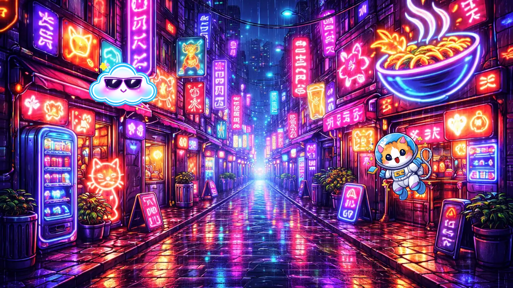
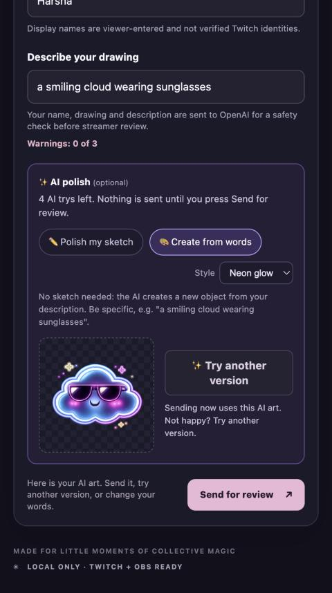
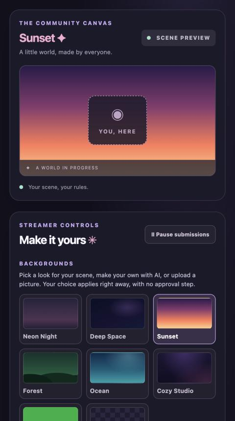
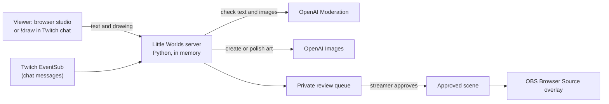
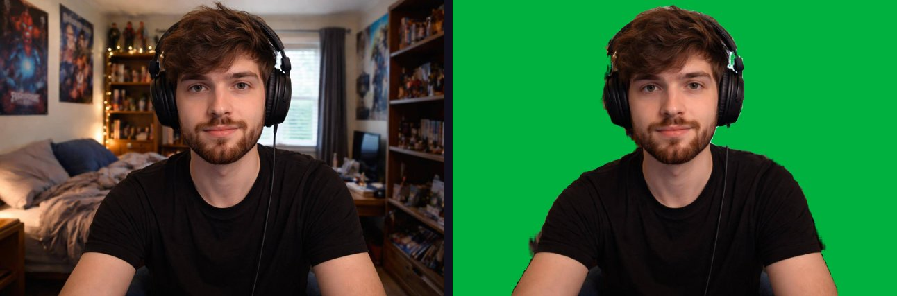

# Little Worlds

**Chat builds the stream.** Viewers make things for a streamer's live scene, by drawing, by describing, or by typing `!draw a neon cat` in Twitch chat. AI turns the idea into art, the streamer approves it with one click, and it appears in OBS on top of their webcam.



*The OBS overlay: the street is an AI background the streamer made, and the cloud and cat were made by viewers and approved in the queue.*

## What it does

1. **Viewers create.** Draw a sketch or just describe what they want. Pick a style (neon, cartoon, pixel art, watercolor, storybook), preview the AI art privately, try again, and send. Or type `!draw ...` in Twitch chat and never leave Twitch.
2. **Viewers choose where it goes:** an object, part of the background, or the full background.
3. **The streamer stays in control.** Every creation lands in a private review queue with a toast and chime. Preview it on the scene, resize it, drag it into place, then approve or reject.
4. **Streamers get a background gallery** like a video call: presets, **Create with AI**, upload, and a transparent mode for the OBS overlay, plus a webcam preview to see how it all looks around you.
5. **OBS shows only what was approved**, updating within a second.

| Viewer AI studio | Streamer backgrounds |
|---|---|
|  |  |

## Safety is part of the design

- Every drawing, description, name and generated picture is checked by OpenAI moderation. If the check is unavailable, the submission is blocked.
- Nothing reaches the stream without the streamer's approval. Viewers get three warnings per room.
- The public tunnel exposes only four viewer endpoints. Streamer controls, the review queue and Twitch tokens stay on `127.0.0.1`, with rate limits and a capped queue.
- Secrets live only in the server process. They are entered at hidden prompts and never written to files or sent to the browser.
- AI image attempts are limited per room (`LITTLE_WORLDS_ART_LIMIT`, default 10, shown in the streamer controls) and per viewer (5 tries). This limits attempts, it is not a billing cap, so also set a monthly spending limit on your OpenAI account.

## How it fits together



The server is one Python file with no framework, plus a small `websockets` dependency for Twitch chat. The front end is plain HTML, CSS and JavaScript. Run the checks with `.venv/bin/python -m unittest discover -s tests -v`, and the overlay test with `node tests/test_output.cjs`.

## Quick start

```sh
python3 -m venv .venv && .venv/bin/python -m pip install -r requirements.txt
scripts/start.sh
```

`scripts/start.sh` asks for your OpenAI key and Twitch app credentials at hidden prompts, optionally takes a Cloudflare Quick Tunnel address for remote viewers, runs a preflight check, and starts the server at http://127.0.0.1:8765. Costs are small: moderation is free, and each AI image is roughly a cent or two.

## Built with Codex

We used Codex Plan mode to explore the idea, research similar tools, and break the work into small milestones before writing code. We reviewed and approved each milestone, then used Codex to build and test the drawing, private approval, OBS, moderation, and Twitch integration flows. When we found problems or wanted a different direction, we described the changes in the same chat and Codex revised the implementation—for example, fixing notification timing, privacy when leaving a room, and out-of-order queue updates. We also reviewed and improved the project ourselves between Codex-assisted iterations.

## Honest limits

- Local-first prototype: rooms live in memory and reset when the server restarts.
- Viewer display names are typed in and not verified. Verified Twitch identity is available through `!draw` only, because Twitch sign-in needs a fixed redirect address and Quick Tunnel addresses change.
- Moderation helps but can miss things, so the streamer's review is the real safeguard.
- A named tunnel and a hosting security review are needed before using this on the open internet.

## License

MIT, see [LICENSE](LICENSE). The files in `vendor/mediapipe/` are third-party (Apache-2.0, Google); see `vendor/mediapipe/NOTICE.md`.

---

## Setup details

Requires Python 3 and an OpenAI API key with access to the moderation endpoint. Twitch chat reading requires the `websockets` Python package. The moderation check uses an internet connection and sends each drawing and its description to OpenAI; the app itself runs only on this computer. OpenAI currently describes the moderation endpoint as free, subject to its terms and limits.

Create and install the approved dependency in an isolated environment once:

```sh
python3 -m venv .venv
.venv/bin/python -m pip install -r requirements.txt
```

1. Stop any earlier Little Worlds server. Restarting it deletes existing rooms and scenes.
2. In macOS Terminal, change to this folder. In zsh, run the following; the key is entered without being displayed and stays in that terminal's environment, not in the project files:

   ```sh
   read -rs 'OPENAI_API_KEY?OpenAI API key: '
   export OPENAI_API_KEY
   .venv/bin/python server.py
   ```

   Never paste a key into chat or commit it to a repository. Keep the terminal open while using the app.
3. Visit http://127.0.0.1:8765 and choose **Create streamer room**. Keep that window private; share only the room code.
4. Open a separate browser tab or window, visit the same address and enter the code under **Join as viewer**. Both windows must be on this computer.
5. Enter a display name, draw, describe the drawing, select a behavior and proposed position, and submit. The server sends the display name, drawing and description to OpenAI for moderation. Display names are self-entered, not verified Twitch identities. A flagged submission is blocked and gives one warning; three warnings block that browser session for the room. Moderation failures block the submission without issuing a warning; retry when the service is available. A passing submission waits privately for streamer approval.
6. The streamer previews and approves or rejects; only approved objects appear to the viewer. The streamer can move or remove objects, pause submissions, and clear the approved scene. New viewer changes require a new submission and approval.
7. Stop the server with Ctrl+C. Rooms, keys, warnings, submissions and scenes are held in memory and lost on server restart. The streamer key remains in the streamer tab's browser session until leaving the room or closing it.

## AI artwork (optional)

Set `LITTLE_WORLDS_AI_ART=1` (together with `OPENAI_API_KEY`) before starting the server. After a drawing passes moderation, the drawing and its description are sent to OpenAI's image model (`gpt-image-1.5`) to be redrawn as polished neon sticker art. The generated picture is moderated too. The streamer sees the AI version in the review queue (marked "AI art") and can approve or reject it; the original drawing is kept private and never goes to the scene or OBS output. If generation fails or the result is flagged, the original drawing is used instead. Image generation is not free and can take up to a minute, so viewers wait longer for their submission to be accepted. Without the flag, nothing is generated.

## AI studio and object size

When AI art is on, the viewer screen has an **AI studio** with two modes and a style picker (neon, cartoon, pixel art, watercolor, storybook):

- **Polish my sketch** redraws the viewer's drawing in the chosen style.
- **Create from words** makes a new object from the description alone, no drawing needed, like an image playground.

Either way the viewer previews the result privately, can try again (5 tries per viewer; the room also has a shared limit set by `LITTLE_WORLDS_ART_LIMIT`, default 10), and only sends what they like. Created images and previews are moderated before the viewer or streamer sees them. In the streamer controls, **Size of selected object** makes a scene object, or a waiting creation you are previewing, bigger or smaller (40% to 300%). The size also applies in the OBS overlay.

## Backgrounds and webcam preview

Viewers choose **Where should it go?** before sending: **An object** (the default), **Part of the background** (a scenery piece that sits behind everyone and everything; it starts larger and the streamer can resize it), or **Full background** (replaces the whole backdrop, always still, drawn wide at 3:2 with compression to keep it light). A newly approved full background replaces the previous one. Streamers can select a full background by clicking an empty part of the scene, then use **Remove selected**.

The streamer controls have a **Webcam preview** that works like a video-call background: **Show only me** (on by default) cuts you out of the camera picture so the scene background shows instead of your room, with Small box, Large and Full scene frames to see how it layers with backgrounds and objects before going live. The cut-out uses Google's MediaPipe selfie segmentation, which runs in the browser tab (the model and WebAssembly are vendored in `vendor/mediapipe/`, see its `NOTICE.md`), so no video is uploaded and it works offline. If the model cannot start, the plain camera is shown instead. If another app such as OBS already holds the camera, the browser may be unable to open it; close it there first. In OBS you still add your real webcam as a separate source above the Browser Source and remove its background there (for example with OBS's background removal filter).



*Left: the camera. Right: what the preview keeps with Show only me (shown on green for contrast; in the app your scene background shows through). The test photo is AI-generated.*

## Prompt helper

Not sure what to type? **💡 Help me with a prompt** (under the description box, and **Help me write it** in the background creator) asks four simple questions: what do you want to make, the mood, the colors, and any extra detail. It writes the prompt as you answer, with idea chips and a **🎲 Surprise me** button (the ideas fit where the picture will go: object, background piece or full background). You can edit the result before **Use this prompt** puts it in the box. It is plain text work with no extra AI call, so it is free and instant, and the prompt is moderated by the server like anything typed by hand. The art style is chosen separately with the Style menu.

## Streamer backgrounds

The streamer controls have a **Backgrounds** gallery, like a video-call background picker. These apply immediately and skip the approval queue:

- **Presets:** Neon Night, Deep Space, Sunset, Forest, Ocean, Cozy Studio, Green screen (for chroma key) and **Transparent**. Presets are plain CSS, so they work offline. Transparent makes the OBS overlay see-through, so only objects show over your webcam or game.
- **Create with AI:** describe a background, pick a style, preview it, then **Use as background**. It needs the AI art setting, counts against the room's AI limit, and the text and picture are moderated.
- **Upload image:** PNG, JPEG or WebP. The browser shrinks it (max 1600 x 900, WebP) before sending, and the image never leaves your computer except to your own local server.

**From your stream:** everything the streamer approves, and every background they make, is saved to a library in the same gallery (newest first, up to 40 per room, kept until the server restarts). One click uses an item as the **full background** or as a **background piece** you can move and resize, and ✕ forgets it. The streamer's controls fetch each picture once, so the live poll stays small, and viewers never see the library.

Picking a preset or **Remove custom background** removes any custom full background, including one a viewer proposed. A new full background replaces the old one.

## Twitch connection (local test)

1. Register an application in the Twitch developer console with the OAuth redirect URL `http://localhost:8765/twitch/callback`. Twitch requires two-factor authentication for developer app registration. Choose a unique app name; keep the generated client secret private.
2. Before starting the server, set `TWITCH_CLIENT_ID` and `TWITCH_CLIENT_SECRET` in the terminal environment. In zsh you can enter them without storing the secret in project files:

   ```sh
   read 'TWITCH_CLIENT_ID?Twitch client ID: '
   read -rs 'TWITCH_CLIENT_SECRET?Twitch client secret: '
   export TWITCH_CLIENT_ID TWITCH_CLIENT_SECRET
   .venv/bin/python server.py
   ```

   Set `OPENAI_API_KEY` in the same terminal too if you want real moderation. Do not paste secrets or access tokens into chat. Stopping the server clears rooms and Twitch authorization.
3. In the streamer room, select **Prepare Twitch sign-in**, then **Authorize on Twitch**. Sign in and grant `user:read:chat` and `user:write:chat` yourself. After the callback confirms success, return to the streamer window.
4. **Send room invitation to chat** posts the configured viewer link when one exists; otherwise it sends a local-only test code. **Announcements** start off; turn them on to post a generic message when a contribution is approved. Chat failure does not undo approval.

The Twitch client secret and access/refresh tokens remain in the server process, not in browser code or project files. This is a local integration, not a hosting-ready authentication system. A separate internet deployment will require a new security review and design. Twitch messages are sent only by the room-code button or when approval announcements are enabled.

## Prepared viewer-only tunnel endpoint

No tunnel is installed or started by this project. If a Quick Tunnel is separately approved and established, configure `PUBLIC_VIEWER_ORIGIN` to its exact `https://<name>.trycloudflare.com` origin before starting the server. Start the tunnel first so its temporary hostname is known; point it only at `http://127.0.0.1:8766`, never at the streamer server on port 8765. Then start the application with that origin configured. Restarting either the server or tunnel changes or resets the room; the tunnel hostname changes when recreated.

The streamer stays on `http://127.0.0.1:8765`. The second loopback endpoint accepts only the viewer page, approved scene state, viewer joins and drawing submissions. It rejects streamer controls, private queues and Twitch authorization even if a request includes a streamer key. It checks the configured host and request origin. Per room it allows at most 20 joins and 10 submissions per minute, plus a 120-request-per-minute global limit for those POST operations and a review queue threshold. These shared limits are basic rehearsal safeguards, not per-person identity enforcement or production abuse prevention. Anyone with the link can try to join. Only approved objects enter the public scene.

The streamer controls provide a room-specific viewer link after the origin is configured. The link only works while the separately approved tunnel is active. With no `PUBLIC_VIEWER_ORIGIN`, the viewer-only listener is not started and the original local setup is unchanged. The local Twitch OAuth callback remains on port 8765. Do not expose that port or the private streamer window.

## Chat-driven creation

With Twitch connected and an OpenAI key configured, enable **!draw** from streamer controls. A viewer can type `!draw a neon cat` in the linked channel. Twitch chat reading runs over EventSub WebSockets. A 60-second cooldown applies per Twitch user; event duplicates are ignored. The server moderates the prompt and generated image, then places the object and Twitch display name in the private approval queue. Drag the private preview to set placement before approval. New chat objects start with the still behavior; the streamer must explicitly approve them.

A room permits at most ten image-generation attempts in total, shared by chat creation and optional drawing polish. Failed generation calls count, and a new room or server restart resets the limit. This is an attempt limit, not a hard monetary cap; model input and output charges apply. Once the limit is reached, chat requests cannot generate; drawing polish falls back to the original drawing. Set account-level budget controls separately.

Moderation flags count towards three warnings per Twitch user per room; service failures do not. The streamer can see a moderation warning in the private chat-creation status. This prototype does not send the viewer a chat warning. The moderation service can miss content, and the queue remains private until approval.

## Local OBS output

1. After creating a streamer room, copy the **OBS Browser Source URL** from the streamer controls. It contains the room code but not the private streamer key.
2. In OBS, add a **Browser Source** and paste the URL. Set its dimensions to 1920 × 1080 (or another 16:9 size).
3. Place your webcam source above the Browser Source in the OBS source list. A normal webcam appears as a rectangle over the world. For the world to appear behind your body, configure your webcam background removal or chroma key in OBS separately.
4. New approvals pop in with sparkles and a temporary creator banner; objects already present on page load do not replay. Choose **Neon Night** or **Deep Space** in streamer controls; the preview and OBS output update together while keeping approved objects in place. The scene page displays only approved objects over the selected scene; it never displays the private review queue or webcam placeholder. Scene changes generally appear within about one second. If the room or local server is unavailable, the page clears its objects. Keep the server running while using OBS. The output is local to the computer running the server.

Moderation can make mistakes and does not detect all categories in images; streamer review is still required. Warning identities are tied to a browser tab session and are easy to reset or evade. A room code is not a password. This prototype is not designed for internet deployment; hosting needs a separate security and architecture review. 

Run the local simulated-service tests with `.venv/bin/python -m unittest discover -s tests -v`. They do not call the API.
